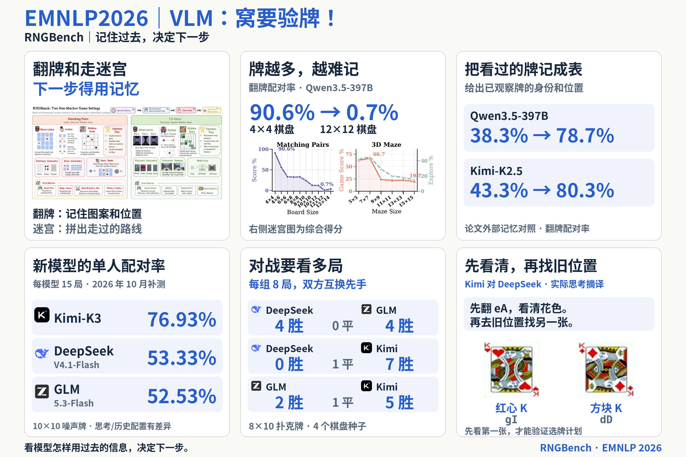

# RNGBench at EMNLP 2026

Text-and-image material introducing RNGBench's memory tasks, paper findings and
October 2026 model evaluations. The Chinese post connects these tasks to the
history-dependent decisions an Agent needs to make. RNGBench evaluates models
in controlled games; complete Agent systems have not been evaluated.

[Title](01_text_images/title.txt) · [Chinese caption](01_text_images/caption.txt)

## Images

The first image is a landscape overview with three columns and two rows. The
remaining four images are original paper figures, in upload order:

1. [Six-card overview](01_text_images/01_overview_3x2.png)
2. [Figure 1: benchmark overview](01_text_images/02_paper_overview.png)
3. [Figure 2: game settings](01_text_images/03_paper_games.png)
4. [Figure 3: scaling](01_text_images/04_paper_scale.png)
5. [Figure 4: external memory](01_text_images/05_paper_memory.png)

## Results and attribution

The new-model results cover 45 single-player games and 24 duels. Kimi-K3 uses
max thinking effort and retains its own returned thinking history; DeepSeek and
GLM use provider defaults. These configurations differ, and the historical Elo
pool is separate. See the [protocol and per-game results](../../docs/results/2026-10-models/README.md).

The lower-right card shows a Chinese translation of Kimi's actual output in a
game against DeepSeek. Its next choice depends on the first card's suit; the
plan still has to be checked by flipping the cards.

Source: [RNGBench paper](https://arxiv.org/abs/2606.19338).
